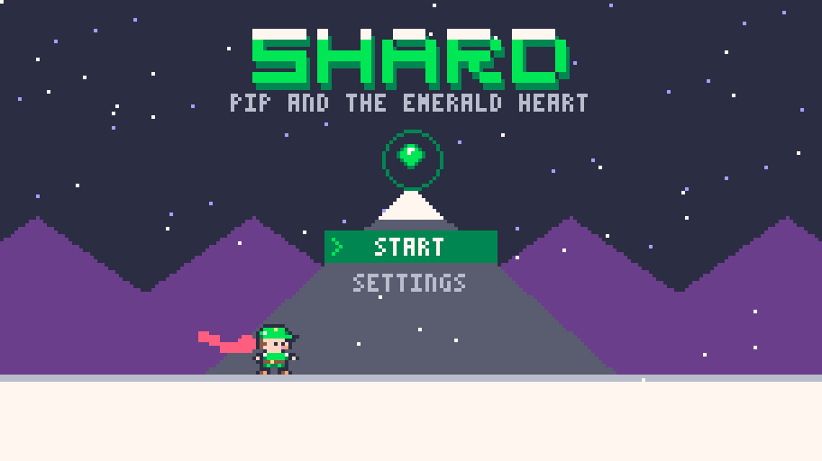

# SHARD: Pip and the Emerald Heart

A pixel platformer about climbing a frozen mountain to bring spring back. 9 levels, a dash, wall crystals, sword combos and a giant Yeti at the top.

**[Play it: download SHARD.zip](SHARD.zip)** (Windows, 28 MB, nothing to install). Unzip it and double-click `SHARD.exe`.

Levels designed and the game directed by me. Code, pixel art and writing made with help from Claude (AI). Made in the Emerald fantasy console.
